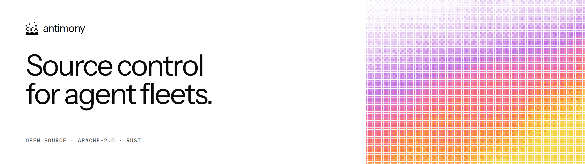
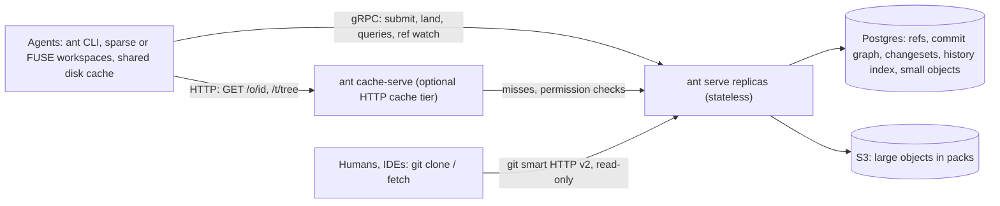

<p align="center">
  <a href="https://github.com/Mapika/antimony">
    <picture>
      <source media="(prefers-color-scheme: dark)" srcset="docs/brand/readme-banner-dark.png">
      
    </picture>
  </a>
</p>

# antimony

Source control for agent fleets.

[](https://github.com/Mapika/antimony/actions/workflows/ci.yml)
[](LICENSE)
[](https://github.com/Mapika/antimony/releases)

When dozens of AI agents commit to one branch of a large monorepo, git's
operating model gets in the way: every agent clones the whole repository,
pushes race and fail, rebases repeat, merge queues serialize the fleet, and
`log` and `blame` walk history on each client. antimony keeps git's object
format and moves everything else to the server: the server builds commits and
lands them onto the moving tip itself, workspaces are lazy and sparse, and
history is an API. It is written in Rust, stores data in Postgres and S3, can
import any git repository with identical SHA-256 ids, serves a read-only git
export for plain git clients, and is licensed Apache-2.0.

## What it does

- **Server-side commits.** An agent sends file edits against a base commit;
  the server builds the trees and the commit. Cost scales with the change,
  not the repository.
- **Land instead of push.** `Land` rebases onto the current tip on the server
  (3-way text merges) and advances the ref by compare-and-swap. No merge
  queue, no global lock; conflicts come back as a list of paths, retries are
  idempotent, stacked commits land together.
- **Lazy, sparse workspaces.** Workspaces materialize only the paths that
  match their sparse patterns, through one disk cache shared by every agent
  on the machine; a FUSE workspace shows the whole tree instantly and fetches
  content on first read.
- **History as an API.** `ls`, `cat`, `log`, `blame`, `diff`, `merge-base`
  and "did this land, and as which commit?" are server queries that need no
  checkout. `ant ref watch` streams every land to post-merge CI.
- **Git compatible.** Objects are git objects with SHA-256 ids; `ant import`
  converts any git repository with ids equal to git's own SHA-256
  conversion, and `git clone` (full, `--filter=blob:none`, `--depth`) and
  `git fetch` work against the server for humans and IDEs.
- **No repository maintenance.** Objects live in Postgres (small) and S3
  packs (large); immutable reads are plain HTTP (`GET /o/<id>`,
  `Cache-Control: immutable`), so any CDN, or the built-in `ant cache-serve`,
  is the cache tier.
- **Built for a fleet.** Stateless server replicas, directory-level access
  control that also protects objects by id, rate limits and load shedding,
  Prometheus metrics.

## How it works

Clients are always online and history lives on the server. An agent's
workspace holds files and a local cache; a submit sends the edits, the server
builds the commit, and a land replays it onto the tip in a group-commit batch
with one compare-and-swap on the ref. Any number of `ant serve` replicas
share one Postgres (refs, commit graph, changesets, path-history index,
objects up to 4 KiB) and one S3 bucket (larger objects, compressed in packs).
Replicas keep only caches of immutable data, so they are interchangeable.



Details: [architecture](docs/architecture.md) (object model, write and read
paths, tree bundles, access control) and the
[operator guide](docs/operator-guide.md) (topology, sizing, runbook).

## Numbers

Measured on one WSL2 development machine (20 cores) with Postgres and
SeaweedFS S3 running locally on the same host. They are indicative, not
guarantees: real networks, managed Postgres and real S3 will move them.
Sources: the [v0.2.0 scorecard](docs/scorecard/2026-10-16-v0.2.0.md)
(27 of 27 rows pass), the [v0.1.0 scorecard](docs/scorecard/2026-10-14-final.md),
[CHANGELOG](CHANGELOG.md) and [ROADMAP](ROADMAP.md).

| measure | result |
|---|---|
| Landing on one ref, 64 concurrent agents, Postgres + S3 | 3,791 lands/s, p99 30.7 ms, 0 aborts, exact history (v0.1.0 run: 4,138/s, 26.5 ms) |
| `create_changeset` p50, 16 agents | 2.0 ms |
| Soak: 4 replicas × 1,000 agents × 30 min | 266k lands, 0 errors, exact history, flat RSS |
| Import git/git (82k commits) | 7,216 commits/s, 0.9 GiB peak RSS |
| Import rust-lang/rust (343k commits, 1.1 GB pack) | 110 s (3,124 commits/s), 1.6 GiB peak RSS |
| Queries on git/git | path log 9 ms (6.7 ms full history, git: 101 ms); blame 47 ms first, 14 ms cached; diverged merge-base 9.3 ms (git: 54 ms) |
| Queries on rust-lang/rust | path log 18 ms; blame 363 ms first, 10 ms cached; `merge-base main main~2000` 10 ms; sparse workspace 134 ms |
| Checkout, synthetic 96k-file tree (medians) | cold 4.7 s, warm 1.1 s, `status` 0.1 s (cold was 2.5 s in v0.1.0; under investigation) |
| git export, `clone --filter=blob:none` of git/git | 5.9 s |
| Stored size of git/git vs its git pack | 901 MiB after import (3.0×; v0.1.0: 13.5×); 361 MiB after `ant admin repack` and GC (298 MiB for `git gc`, 94 MiB for `git gc --aggressive`) |

## How it compares to git

antimony is not a git replacement for every workflow. It targets one case:
many always-online writers on one large repository. A
[head-to-head against tuned git](docs/scorecard/2026-10-16-vs-git.md) on the
same machine (git/git and a 96k-file synthetic tree; git with aggressive gc,
bitmaps, commit-graph with changed-path filters, untracked cache, cone sparse
checkout, partial clone) measured:

| operation | git | antimony |
|---|---|---|
| landing storm, 64 agents on one branch | 15.6 commits/s, p99 1.65 s (25 push attempts per change) | 2,287 commits/s, p99 137 ms |
| checkout of the 96k-file tree, cold / warm | 18.8 s / 10.7 s | 7.0 s / 1.2 s |
| sparse checkout, cold / warm | 2.9 s / 1.5 s | 1.05 s / 0.19 s |
| blame, repeated / after a new commit | 323 ms / 307 ms | 19 ms / 16 ms |
| merge-base, ancestor 12k commits back | 56 ms | 10 ms |
| path log, full history | 101 ms | 6.7 ms (210 ms before 0.2.0) |
| merge-base, diverged branches | 54 ms | 9.3 ms (193 ms before 0.2.0) |
| status, clean, repeated | 78 ms | 118 ms |
| storage (git/git) | 105 MiB (`gc --aggressive`) | 901 MiB after import, 361 MiB after `ant admin repack` (Postgres + S3) |
| `git clone --filter=blob:none` | 1.5 s | 5.9 s quiet machine, 32 s in the loaded head-to-head run (from antimony's git export) |

Where antimony is ahead: concurrent landing (the server rebases and lands;
agents never fetch, rebase and retry a rejected push), checkout and sparse
workspaces, and repeated history queries, which come from server-side
indexes and caches with no history on the client.

Where git is ahead: storage size, serving clones (git reuses its packs;
antimony's export builds packs on the fly), offline work, and the ecosystem (hosting, code review,
tooling; antimony's export accepts no pushes). antimony is 0.x; lazy FUSE
workspaces are Linux only. The report lists the caveats: one shared machine,
different work per change in the storm, and git's weaker default durability.

## Quickstart

Needs `git` and `curl`, plus one of:

- **A release binary** (x86_64 Linux) from
  [Releases](https://github.com/Mapika/antimony/releases): unpack
  `ant-v0.1.0-x86_64-unknown-linux-gnu.tar.gz`, check it against
  `SHA256SUMS`, put the directory holding `ant` on your `PATH`, and skip the
  first two lines below.
- **Rust** (1.90 or newer) to build from source, as below.
- **Docker** for the server: `docker run -d -p 7420:7420 -p 7421:7421
  ghcr.io/mapika/antimony:0.2.0 serve --memory` can replace the `ant serve`
  line of step 1 (the client steps still need an `ant` binary).

The quickstart runs against an in-memory throwaway server; for a durable one
add Postgres and an S3-compatible store (`docker compose up -d`, or
`scripts/dev-services.sh start` without Docker) and see
[docs/operations.md](docs/operations.md). Run it from the repository root;
the demo lives in `/tmp/ant-demo`.

```sh
cargo build --release                      # one binary: target/release/ant (server + client)
export PATH=$PWD/target/release:$PATH

# 1. Start an empty in-memory server (gRPC :7420, HTTP :7421).
rm -rf /tmp/ant-demo && mkdir -p /tmp/ant-demo
ant serve --memory > /tmp/ant-demo/serve.log 2>&1 &
SERVER_PID=$!
until curl -sf http://127.0.0.1:7421/healthz >/dev/null; do sleep 0.2; done

# 2. Create the first commit (an empty root commit on `main`), then put some files in it.
ant ref init main                          # prints: <root-commit-id>
ant ws new /tmp/ant-demo/seed
mkdir /tmp/ant-demo/seed/src
printf 'pub fn answer() -> u32 {\n    41\n}\n' > /tmp/ant-demo/seed/src/lib.rs
echo '# demo' > /tmp/ant-demo/seed/README.md
(cd /tmp/ant-demo/seed && ant submit -m "initial import" && ant land)    # landed <id>

# 3. Read without checking anything out.
ant ls main                                # <mode> <kind> <id><TAB><name>
ant cat main:src/lib.rs
ant log main -n 5

# 4. Two agents, two sparse workspaces, one file: the first lands, the second conflicts.
ant ws new /tmp/ant-demo/a --sparse src
ant ws new /tmp/ant-demo/b --sparse src
echo '// from a' >> /tmp/ant-demo/a/src/lib.rs
echo '// from b' >> /tmp/ant-demo/b/src/lib.rs
cd /tmp/ant-demo/a && ant status && ant submit -m "a: comment" && ant land   # landed <id>
cd /tmp/ant-demo/b && ant submit -m "b: comment"; ant land; echo "exit $?"    # conflict, src/lib.rs, exit 2

# 5. Carry b's edit onto the new tip: both appended at the same spot, so resolve and retry.
ant ws update; echo "exit $?"              # updated <id>, C<TAB>src/lib.rs, exit 2
ant status                                 # C<TAB>src/lib.rs
cat src/lib.rs                             # <<<<<<< upstream ... >>>>>>> local
printf 'pub fn answer() -> u32 {\n    41\n}\n// from a\n// from b\n' > src/lib.rs
ant ws resolve src/lib.rs && ant submit -m "b: comment" && ant land        # landed <id>

# 6. History.
ant log main --path src/lib.rs
ant diff main~1 main                       # M<TAB>src/lib.rs
ant diff --patch main~1 main               # unified diff, computed by the server
ant log main~2..main -- src                # a range, first parents
ant landed-as <submitted-id>               # <landed-id> main [rebased]
ant blame main:src/lib.rs

# 7. Humans and IDEs use plain git; Prometheus scrapes the HTTP port.
git clone -q http://127.0.0.1:7421/repo.git /tmp/ant-demo/clone
curl -s http://127.0.0.1:7421/metrics | grep '^ant_land_outcomes'

# 8. Clean up.
kill $SERVER_PID; cd / && rm -rf /tmp/ant-demo
```

Exit codes: `0` ok, `1` error (`error: ...` plus an optional `hint: ...` on
stderr), `2` land or update conflict. More in [docs/usage.md](docs/usage.md):
conflicts and `ws update`, lazy workspaces, access control in two minutes,
importing large histories, Docker, several replicas.

## Using it

| task | command |
|---|---|
| Start a workspace | `ant ws new <dir> [--at <rev>] [--sparse <pattern>]...` or `--lazy` (FUSE) |
| See local changes | `ant status [--ignored]` |
| Commit on the server | `ant submit -m <message>` |
| Land onto a ref | `ant land [--ref <name>] [<commit>]` (exit 2 on conflict) |
| Catch up, resolve conflicts | `ant ws update [--to <rev>]`, then `ant ws resolve <path>...` |
| Read without a checkout | `ant ls <rev>[:<path>]`, `ant cat <rev>:<path>`, `ant mount <rev> <dir>` |
| History | `ant log [<rev> \| <a>..<b>] [-n N] [-- <path>]` |
| Blame | `ant blame <rev>:<path>` |
| Diff | `ant diff [--patch [-U N]] [--merge-base] <a> <b> [-- <path>...]` |
| Merge base | `ant merge-base <a> <b>` |
| Did it land, as what? | `ant landed-as <commit> [--ref <name>]` |
| Stream lands to CI | `ant ref watch <ref> [--from <rev>]` |
| Refs | `ant ref get`, `list`, `set` (`--force` for non-fast-forward), `init` |
| Client cache | `ant cache stats`, `ant cache gc`, `ant cache seed <rev>[:<path>]` |
| Cache tier | `ant cache-serve --cache <dir> --upstream <origin-http-url>` |
| Import from git | `ant import <git-dir> [--git-ref refs/heads/main] [--ref main] <store flags>` |
| Clone with plain git | `git clone [--filter=blob:none \| --depth N] http://<server>:7421/repo.git` |
| Run a server | `ant serve [--memory \| --pg-url ... --s3-endpoint ...] [--policy policy.toml]` |
| Administer | `ant admin schema`, `ant admin gc`, `ant admin reindex-acl` |

Output is one record per line; the full contract is in the module docs of
[`crates/ant-cli/src/main.rs`](crates/ant-cli/src/main.rs). Clients find the
server via `ANT_SERVER` (default `http://127.0.0.1:7420`) and send
`ANT_TOKEN` when the server has a policy. `ant <command> --help` documents
every flag; `ant completions <shell>` prints a completion script.

## Status

- **v0.2.0** (2026-10-16): storage format change (look-alike objects
  compressed together in S3 packs, whole-history repacking with
  `ant admin repack`; schema version 7, see the upgrade notes in
  [operations](docs/operations.md)), incremental blame, faster path log and
  merge-base, a cache tier (`ant cache-serve`) with batched permission
  checks, and S3 throttling handled with backoff.
- **v0.1.0** (2026-10-16) was the first release: working end to end against
  real Postgres and S3, FUSE included, covered by unit, integration and
  property tests (codecs, changesets, landing single and multi-replica,
  garbage collection).
- **Known limitations**: one Postgres primary (no multi-region); FUSE
  workspaces are Linux only; the git export is read-only; no code review;
  storage is larger than an aggressively packed git repository; commit latency is bounded by one
  durable Postgres commit; restricted tree entry names and commit metadata
  are visible to every authenticated principal. Full list:
  [CHANGELOG, known limitations](CHANGELOG.md#known-limitations).

Open work is in [ROADMAP.md](ROADMAP.md); how antimony maps onto the design it
recreates is in [docs/scion-gap.md](docs/scion-gap.md).

## Documentation

- [Usage](docs/usage.md): conflicts and `ws update`, lazy workspaces, access
  control quickstart, large imports, Docker, several replicas.
- [Architecture](docs/architecture.md): crates, object model, storage, write
  and read paths, clients, git interop, access control.
- [Access control and threat model](docs/access-control.md): what a policy
  protects and its v1 limitations.
- [Operations](docs/operations.md): running a server, S3 timeouts, metrics,
  imports, policies, sizing, upgrading, local services, benchmarks.
- [Operator guide](docs/operator-guide.md): topology, sizing, cache tier,
  fleet workflow, rate limits, metrics and alerts, failure runbook, backups.
- [Compatibility](docs/compatibility.md): what each 0.x release keeps stable
  (API, Postgres schema, on-disk formats, CLI output) and how deprecations
  work.
- [Scorecards](docs/scorecard/): measured performance against the v1
  targets.
- [Gap analysis](docs/scion-gap.md) against "Redesigning source control".
- [Lazy-workspace write performance contract](docs/contracts/rw-write-performance.md).
- [Changelog](CHANGELOG.md), [roadmap](ROADMAP.md) and
  [release checklist](docs/release.md).

## Contributing

Contributor conventions are in [AGENTS.md](AGENTS.md) (also `CLAUDE.md`):
crate layout, error style per layer, performance rules and the development
loop. Tests are the spec: behaviour is pinned by unit, integration and
property tests, and a change never weakens, deletes or ignores one. CI
rejects code that is not `cargo fmt`-formatted or has clippy warnings. The
compatibility surfaces in [docs/compatibility.md](docs/compatibility.md)
change only deliberately.

## Acknowledgements

antimony is an open-source recreation of the ideas in Anthropic's
[*Redesigning source control at Anthropic*](https://www.anthropic.com/engineering/redesigning-source-control),
which describes Scion, Anthropic's in-house version control system. antimony
is an independent project: it is not affiliated with or endorsed by
Anthropic.

## License

[Apache-2.0](LICENSE)
